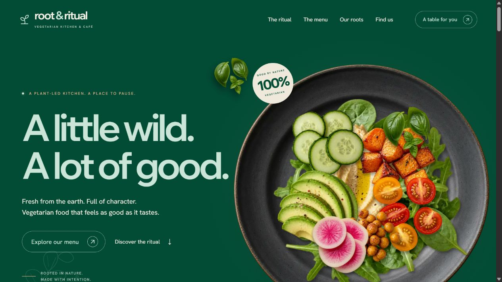

# Root & Ritual

A fictional vegetarian restaurant and café in Portland, Oregon. A portfolio website with a layered food animation, a scroll-driven preparation sequence and an interactive seasonal menu.

**Live site:** https://root-and-ritual-sooty.vercel.app

**Source repository:** https://github.com/kreatorrdev/root-and-ritual (private)

**Local preview:** http://127.0.0.1:3000

Published to Vercel on October 19, 2026. All venue details, dishes, prices, opening hours and photographs are illustrative. The reservation form is a non-submitting demo.



## Run locally

Node.js 22.13 or later is required. Node.js 26 was used for development.

```sh
npm install
npm run dev
```

Open http://127.0.0.1:3000 in your browser. On Windows, use `npm.cmd` if PowerShell blocks the `npm.ps1` shim. The package scripts invoke their tools through Node directly so the `&` in this workspace folder name does not break Windows command shims.

## The experience

- Deep forest green, pale mint typography, copper accents, warm paper surfaces and botanical line art, informed by the Kitchen Remedy reference.
- An empty ceramic plate fills with individually animated photographic ingredients. The replay button starts the sequence again; pointer movement adds subtle depth on desktop.
- Native scrolling controls a four-part sequence: gather, prepare, roast and plate. Damped progress and staggered ingredient motion soften the transitions. Relative positions keep the food inside the visual, and fixed step descriptions prevent layout jumps.
- Menu headings and cards reveal on entry into the viewport. Category and dietary filters combine, with a clear empty state.
- Twelve typed menu entries, consistent vegetarian/vegan/gluten-free tags, USD prices and ingredient/allergen dialogs.
- Accessible native dialogs, keyboard-operable gallery, responsive navigation and support for `prefers-reduced-motion`.
- Self-hosted Wix Madefor Display headings and Hanken Grotesk body text, with optimized Next.js images. Metadata and social preview information are included.
- React Hook Form and Zod validate name, email, dates, service hours, guest counts and a spam honeypot on both client and server.

## Reservation behavior

Without `RESERVATION_FORM_ENDPOINT`, the endpoint validates the preview and returns an explicit **demo / not submitted** result. It does not save contact details or make a booking. No provider account, API key or database is needed for the local demo.

Validation uses `America/Los_Angeles`, not the visitor's timezone. Mondays are closed; service slots follow the illustrative published hours. Requests are limited to 1–8 guests and the next 90 days.

A future verified Formspree integration can be enabled using the commented example in `.env.example`. Only `https://formspree.io/f/<form-id>` endpoints are accepted. The implementation reports provider failures honestly and never claims that a booking is confirmed. Real provider success/failure delivery has not been tested because no account or destination has been configured.

## Checks

```sh
npm run lint
npm run typecheck
npm test
npm run build
```

Automated tests check dietary/category intersections, recipe-label consistency, invalid dates, date bounds, service hours, Monday closure, past times and a daylight-saving transition. The local HTTP endpoint was also checked for a valid demo response, invalid input, a filled honeypot, malformed JSON, an unsupported content type and oversized input.

Browser review covers desktop and narrow phone layouts, mobile navigation, menu filtering and empty states, dish details, gallery navigation, form errors and the demo result. Production checks confirmed the public page, optimized images, menu filters, social metadata and demo reservation response. No Lighthouse score is claimed.

## Stack

Next.js App Router · React · TypeScript · Tailwind CSS 4 · React Hook Form · Zod · Lucide · native CSS animations, IntersectionObserver and requestAnimationFrame.

## Project structure

```text
src/app/                 Page, metadata, styles and reservation endpoint
src/components/          Layout, animations, menu, dialogs, gallery and form
src/data/menu.ts         Twelve sample dishes and menu filtering
src/lib/validation.ts    Shared validation and Portland service hours
src/types/menu.ts        Typed menu model
public/images/          Generated photographic assets
public/fonts/           Self-hosted open-license fonts and license notices
tests/                  Menu and validation tests
docs/                   Case study, asset prompts and screenshots
```

## Assets and portfolio notes

All production food and venue photographs were generated for this fictional concept using the built-in image generation tool. The reference screenshots guide the art direction; they are not copied into the published interface. Full asset paths, prompts and font license information are in [docs/ASSETS.md](docs/ASSETS.md).

All project documentation is in English:

- [Design brief](DESIGN_BRIEF.md): visual direction, content requirements and interactions.
- [Project roadmap](PROJECT_ROADMAP.md): implementation checklist and release status.
- [Case study](docs/CASE_STUDY.md): design decisions, implementation and validation.
- [Assets and licenses](docs/ASSETS.md): image generation prompts, fonts and attribution.

## GitHub and Vercel deployment

The GitHub repository is connected to the existing Vercel project. The production branch is `main`; pushing updates to that branch triggers a Vercel deployment. The live URL remains https://root-and-ritual-sooty.vercel.app.

For a manual deployment from a new checkout:

```sh
npx vercel login
npx vercel link --project root-and-ritual --yes
npx vercel deploy --prod
```

Use the Next.js preset and keep `RESERVATION_FORM_ENDPOINT` unset for the portfolio demo. Metadata automatically uses Vercel's production domain; `NEXT_PUBLIC_SITE_URL` can override it for a custom HTTPS domain. The `.vercelignore` file excludes local build output, environment files, temporary files and review screenshots. After further source edits, run `npx vercel deploy --prod` from the linked folder.

The first production deployment returned `READY`. Anonymous requests to the page and optimized image returned HTTP 200, a valid sample reservation returned HTTP 200 with explicit `demo` status, and the temporary review helper returned HTTP 404. Browser review confirmed the vegan filter, complete images and the production domain in Open Graph metadata.

The repository contains the application, generated assets, English documentation and portfolio screenshots. Local environment files, Vercel credentials, dependencies, temporary files and build output are excluded. No paid plan, custom domain or form-delivery destination has been created.
